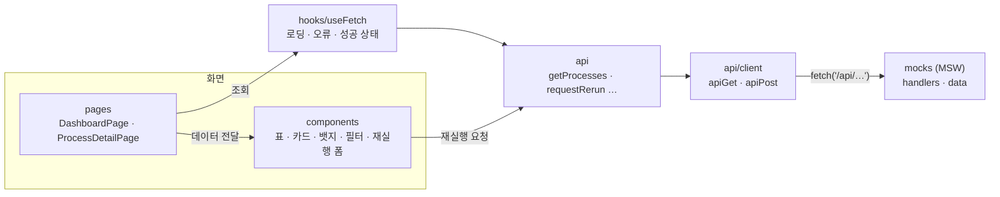

# RPA 운영 대시보드

RPA 운영 담당자가 자동화 프로세스의 상태와 오류를 한눈에 확인하고, 필요할 때 기준일자를 지정해 수기 재실행을 요청하는 사내 도구입니다.

- **배포**: https://rpa-ops-dashboard.vercel.app
- **버전**: v1.0.0 (MVP 완성)

> **MSW 목 API 데모입니다.** 실제 서버 없이 브라우저에서 [MSW](https://mswjs.io/)가 API 응답을 대신합니다. 모든 데이터는 가상이며, 새로고침하면 초기화됩니다.

## 주요 기능

| 기능 | 내용 |
|---|---|
| 오늘 요약 | 오늘 실행 건수 · 성공률 · 오류 건수 카드. 성공률은 완료된 실행 기준이며, 완료 건이 없으면 `-` |
| 프로세스 목록 | 이름 · 담당 부서 · 실행 방식(예약/수기) · 최근 상태 뱃지 · 최근 실행 시각 |
| 필터 · 검색 | 받아온 목록을 화면에서 상태(이력 없음 포함) · 실행 방식 · 이름으로 필터링 |
| 프로세스 상세 | 프로세스 정보와 실행 이력 · 오류를 한 표로 표시 (최근 20건) |
| 수기 재실행 | 기준일자 입력 → 202 접수 / 400 잘못된 기준일자 / 409 이미 실행 중 결과 표시 |
| 화면 상태 처리 | API를 호출하는 영역마다 로딩 · 오류 · 빈 결과를 표시. 영역끼리 서로 독립적으로 동작 |

MVP 범위 밖: 로그인 · 권한, 자동 새로고침, 정렬 · 페이지네이션, 재실행 후 이력 자동 갱신

## 로드맵

- [x] 환경 세팅 (Vite, GitHub, Vercel)
- [x] API 명세 + 타입 정의
- [x] MSW 목 API + 가상 데이터
- [x] 오늘 요약 카드
- [x] 프로세스 목록 + 상태 뱃지
- [x] README v0.1
- [x] 필터 · 검색 (상태 · 실행 방식 · 이름)
- [x] 프로세스 상세 (실행 이력과 오류, 최근 20건)
- [x] 수기 재실행 (기준일자 입력 → 202 접수 / 400 잘못된 기준일자 / 409 이미 실행 중)
- [x] 공통화 리팩터링 (fetch 래퍼 `apiGet`·`apiPost`, 커스텀 훅 `useFetch`)
- [x] README 완성, v1.0.0

## 기술 스택

React 19 · TypeScript 6 · React Router 8 · Vite 8 · MSW 2 · Vercel

- 데이터 요청은 `fetch` + `useState`/`useEffect`로 직접 구현했습니다. 데이터 패칭·상태 관리 라이브러리는 쓰지 않습니다.
- UI 라이브러리 없이 컴포넌트와 CSS를 직접 작성했습니다.

## 구조

### 요청 흐름



- **화면**(`pages`)은 `useFetch`에 조회 함수를 넘기고, 돌려받은 상태(로딩 · 오류 · 성공)에 맞춰 그립니다. 재실행처럼 사용자 동작으로 시작하는 요청은 컴포넌트의 이벤트 핸들러에서 직접 부릅니다.
- `api/client`는 모든 요청이 지나가는 공통 함수입니다. `res.ok`를 확인하고, 실패하면 서버의 오류 메시지(`{ code, message }`)나 기본 문구를 담은 `Error`를 던집니다.
- **MSW**가 네트워크 단계에서 `fetch('/api/…')`를 가로채 명세대로 응답합니다. 앱 코드는 실서버를 부를 때와 같으므로, 실서버가 생기면 `src/mocks`와 워커 시작 코드(`main.tsx`)만 걷어 내면 됩니다.

### 폴더

```
docs/
  api-spec.md           API 명세 (기준 문서)
  ax-log.md             AI 협업 세션 기록
src/
  types/                명세와 1:1로 맞춘 타입 (common · summary · process)
  api/                  client.ts(공통 fetch 래퍼) + 엔드포인트별 함수
  hooks/                useFetch (조회 상태 공통화)
  pages/                화면 (DashboardPage, ProcessDetailPage, NotFoundPage)
  components/           재사용 컴포넌트 (요약 카드, 목록·이력 표, 필터 바, 상태 뱃지, 재실행 폼 등)
  utils/                표시용 포맷 함수
  mocks/                MSW 핸들러 · 가상 데이터 (현재 시각 기준 상대 날짜)
public/
  mockServiceWorker.js  MSW Service Worker
vercel.json             딥링크 새로고침을 위한 SPA rewrites
```

### 화면

| 경로 | 화면 |
|---|---|
| `/` | 오늘 요약 + 프로세스 목록(필터 · 검색) |
| `/processes/:id` | 프로세스 정보 + 수기 재실행 + 실행 이력 |
| 그 밖의 경로 | 페이지 없음 |

## 핵심 타입

API 타입은 [명세](docs/api-spec.md)와 1:1로 `src/types/`에 정의했습니다. `any`는 쓰지 않습니다.

**상태 값은 유니온 리터럴 타입** — 정의되지 않은 값은 컴파일 단계에서 막힙니다.

```ts
// src/types/common.ts
export type RunStatus = 'success' | 'failed' | 'running';
export type TriggerType = 'scheduled' | 'manual';
export type ErrorType = 'timeout' | 'element_not_found' | 'login_failed' | 'data_error' | 'system_error';
```

**실행 이력** — 값이 없을 수 있는 필드는 생략하지 않고 `T | null`로 둡니다.

```ts
// src/types/process.ts
export interface Run {
  id: string;
  status: RunStatus;
  triggerType: TriggerType;
  baseDate: DateString;
  startedAt: DateTimeString;
  endedAt: DateTimeString | null; // 실행 중이면 null
  error: RunError | null;         // status가 'failed'일 때만 값이 있음
}
```

**화면 조회 상태는 판별 유니온** — `status`를 확인해야 `data`나 `message`를 쓸 수 있어서, 로딩 중에 데이터를 그리는 실수를 타입이 막아 줍니다.

```ts
// src/hooks/useFetch.ts
export type FetchState<T> =
  | { status: 'loading' }
  | { status: 'error'; message: string }
  | { status: 'success'; data: T };

export function useFetch<T>(fetcher: () => Promise<T>): FetchState<T>;
```

## API

명세 전문: [docs/api-spec.md](docs/api-spec.md)

| 메서드 | 경로 | 설명 | 성공 | 오류 |
|---|---|---|---|---|
| GET | `/api/summary` | 오늘 요약 | 200 | |
| GET | `/api/processes` | 프로세스 목록 (최근 실행 상태 포함) | 200 | |
| GET | `/api/processes/{id}` | 프로세스 상세 | 200 | 404 |
| GET | `/api/processes/{id}/runs` | 실행 이력 (최신순 최근 20건) | 200 | 404 |
| POST | `/api/processes/{id}/runs` | 수기 재실행 요청 (body: `{ "baseDate": "YYYY-MM-DD" }`) | 202 | 400 · 404 · 409 |

**오류 응답** (4xx · 5xx 공통): `{ "code": "PROCESS_NOT_FOUND", "message": "프로세스를 찾을 수 없습니다: PRC-999" }`

| HTTP | `code` | 조건 |
|---|---|---|
| 400 | `INVALID_BASE_DATE` | 기준일자 누락 · 형식 오류 · 없는 날짜 · 미래 날짜 |
| 404 | `PROCESS_NOT_FOUND` | 프로세스 없음 |
| 409 | `PROCESS_ALREADY_RUNNING` | 이미 실행 중 |

- 재실행 요청은 실행 완료를 기다리지 않고 **접수만** 하므로 `202 Accepted`입니다.
- 검사 순서는 404 → 400 → 409입니다. 없는 프로세스라면 기준일자를 검사할 필요가 없기 때문입니다.
- 일시는 ISO 8601 + KST 오프셋(`2026-09-24T09:30:00+09:00`), 날짜는 `YYYY-MM-DD`입니다.

## AI 협업 (AX) 요약

Claude Code와 함께 개발했습니다. 학습이 목적이라 아래처럼 역할을 나눠 **핵심 로직은 직접 작성하는 것을 원칙**으로 했고, AI에게 작성이나 수정을 맡긴 부분은 세션별 기록에 남겼습니다. 규칙은 [CLAUDE.md](CLAUDE.md)에, 세션별 기록은 [docs/ax-log.md](docs/ax-log.md)에 있습니다.

| AI에게 맡긴 것 | 직접 한 것 |
|---|---|
| 설정 파일 · 뼈대 · 반복 코드 · 새 패턴의 첫 예시 | 같은 패턴의 두 번째부터, 상태 · 이벤트 처리 · fetch · 타입 정의 같은 핵심 로직 |
| API 명세 초안, 구조 제안, 코드 리뷰 | 명세 · 구조 채택 여부와 리뷰 반영 여부 판단 |

**직접 판단한 주요 결정** (자세한 내용은 AX 로그)

- 실행 상태에 `running` 추가 — 지금 실행 중인 프로세스를 확인하려면 꼭 필요한 값이어서
- 목 API로 MSW 도입 — 백엔드 없이도 실제 API 호출 흐름을 화면에서 확인하려고
- 화면 전환에 React Router 도입 — 상세 화면을 URL로 나눠 주소 공유 · 새로고침 · 뒤로가기가 되도록
- 기준일자 입력에 `max`(오늘) 지정 — 서버 오류(400)를 받기 전에 입력 단계에서 막는 편이 사용자에게 친절해서
- 공통 래퍼에서 `apiDelete` 제외 — 명세에 DELETE 요청이 없어 쓸 곳이 없어서

**진행 방식**: 단계마다 `목표 → 코드 → 핵심 개념 → 직접 해볼 과제 → 확인 방법` 순서로 진행했습니다. 기능마다 브랜치를 만들고, AI 코드 리뷰에서 반영할 내용을 판단해 수정 커밋으로 남긴 뒤 PR로 병합했습니다. 리뷰 반영 이력이 남도록 squash가 아닌 merge commit을 사용합니다.

## 로컬 실행

Node 24 LTS 기준입니다.

```bash
npm install
npm run dev      # http://localhost:5173
npm run build    # 타입 검사 + 프로덕션 빌드
npm run lint
```
